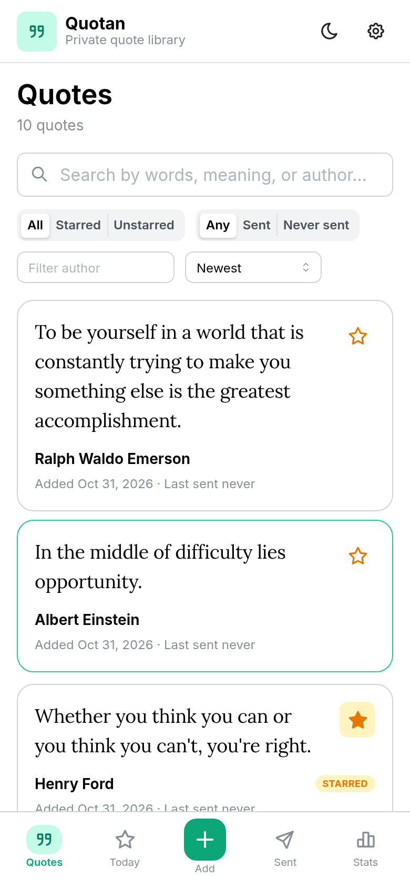
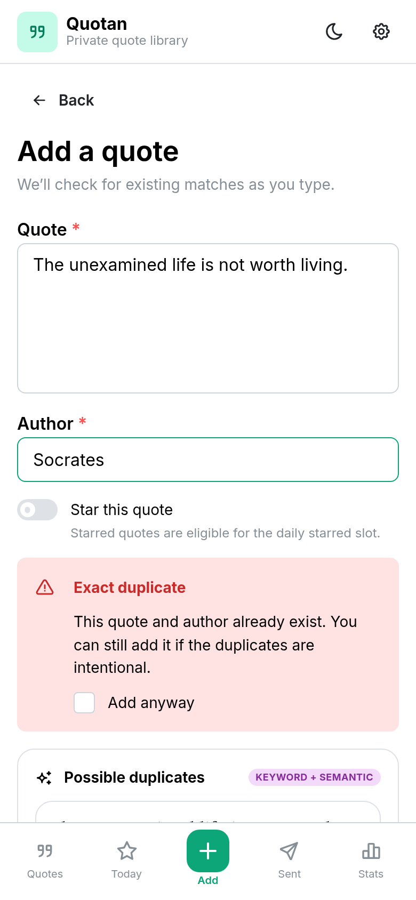
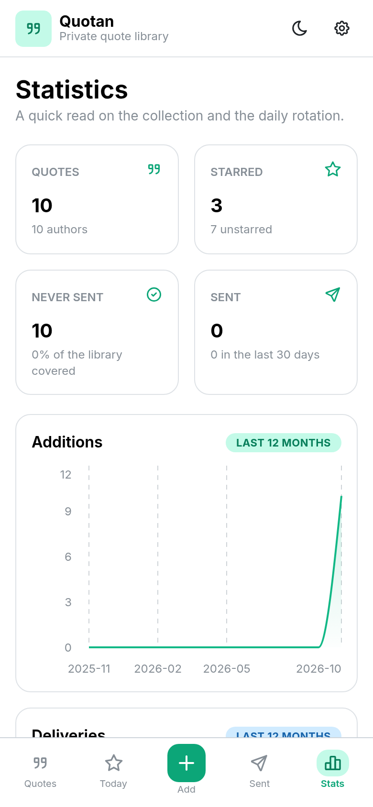

# Quotan

A private, single-user quote library with hybrid keyword + semantic search, duplicate
detection while you type, import/export, and a four-state workflow — **Starred**, **Inbox**,
**Private**, and **Dropped**. Quotan sends one Starred and one Inbox quote to Telegram every
day, then archives the Inbox quote automatically so the library keeps moving.

Quotan is deliberately small: one Node process, one SQLite database, one login, one
API key. It is designed to run behind Traefik as a Docker container.

## Features

- **Hybrid search** — SQLite FTS5/BM25 plus embedding cosine similarity, fused with
  Reciprocal Rank Fusion. Search as you type with a 300 ms debounce.
- **Duplicate awareness** — exact, near-text, and semantic matches are shown while adding
  or editing a quote. Imports are kept direct; use the Duplicates tab afterward.
- **Library duplicate scan** — a Duplicates tab scans existing quotes and clusters exact,
  different-author, near-text, and semantic matches for review. Strong matches merge into
  one group only when every pair in it agrees (complete linkage); weaker pairs are shown
  once per quote instead of once per pair.
- **Four-state workflow** — every quote is Starred, Inbox, Private, or Dropped. Private is
  never sent. Dropped is a searchable archive that blocks exact re-imports.
- **Fast browsing** — virtualized quote and delivery lists; filter by status, sent status,
  author, and date; sort by newest, oldest, author, or last sent.
- **Daily Telegram delivery** — Quotan sends one Starred and one Inbox quote each day,
  prioritized toward the least recently sent, deterministic per day, and idempotent. The
  Inbox quote is moved to Dropped after a successful send; keep it from Today if you liked it.
- **One-way Telegram** — outbound messages only. No bot commands, replies, webhooks, or
  inline buttons.
- **PWA** — installable on mobile, offline shell and cached read-only lists, safe-area
  layouts, and a bottom navigation bar.
- **Embedding-aware reindexing** — changing the model or its dtype/pooling/prefixes triggers a
  background rebuild. Search falls back to keywords while it runs.
- **Import / export** — CSV, JSON, paste, and a full SQLite backup.
- **Statistics** — active and per-status counts, collection growth, delivery history, top
  authors, streak, and embedding index health.

### A quick look

| Quotes                                                  | Add with duplicate check                                | Statistics                                                 |
| ------------------------------------------------------- | ------------------------------------------------------- | ---------------------------------------------------------- |
|  |  |  |

## Stack

- Node 24, npm workspaces, TypeScript strict
- Fastify 5, Zod 4, Drizzle ORM + better-sqlite3, SQLite FTS5
- In-process embeddings: Transformers.js + ONNX Runtime (CPU)
- React 19, Vite, Mantine 9, TanStack Query/Virtual, React Router, Recharts
- `vite-plugin-pwa` / Workbox
- Biome, Vitest, Playwright
- Docker + Traefik

## Quick start

```bash
# Node 22.12+ or 24; npm 10+
npm install
npm run build:shared

cp .env.example .env
# For a local demo, edit .env to:
#   DATABASE_PATH=./data/quotan.sqlite
#   PUBLIC_ORIGIN=http://localhost:5173
#   COOKIE_SECURE=false
#   AUTH_PASSWORD=quotan
#   API_KEY=dev-api-key-change-me
#   EMBEDDING_PROVIDER=local
#   DOCS_ENABLED=true
# Optional for real Telegram delivery:
#   TELEGRAM_BOT_TOKEN=123456:...
#   TELEGRAM_CHAT_ID=123456789
#   DAILY_SEND_TIME=09:00

npm run dev
```

Open <http://localhost:5173> and sign in with `quotan` (or the password you configured).
The API runs on `http://localhost:3000`; Vite proxies `/api` to it.

On first use, the local provider downloads the Hugging Face model into `data/models`
(`/data/models` in Docker) and caches it there. The default is
`onnx-community/granite-embedding-small-english-r2-ONNX`: a 47M-parameter,
384-dimension English model with an 8192-token context that still runs comfortably on a
CPU. Set `EMBEDDING_PROVIDER=none` for keyword-only search, or `mock` for deterministic
test vectors. Model files are downloaded, but quote text never leaves the process.

### Useful commands

```bash
npm run dev             # API + Vite dev server
npm test                # API + web unit/integration tests
npm run test:e2e        # build and run Playwright (needs `npx playwright install chromium`)
npm run lint            # Biome
npm run format          # Biome write
npm run typecheck       # API, web, shared, and scripts
npm run build           # production API + web
npm run auth:hash       # generate AUTH_PASSWORD_HASH
npm run api:key         # generate API_KEY
npm run model:download  # pre-download the configured local embedding model
npm run seed            # add sample quotes to an empty database
npm run rebuild-fts     # maintenance: rebuild the FTS index
```

## Development with devenv

The repository uses [devenv](https://devenv.sh) with git-hooks, matching the referenced
`polythought` setup:

```bash
devenv shell
```

The shell installs npm dependencies if `node_modules` is missing, builds the shared
package, and installs the hooks declared in [`devenv.nix`](devenv.nix). The generated
`.pre-commit-config.yaml` is intentionally ignored; edit `devenv.nix` to change hooks.

Hooks include Biome, typecheck, YAML/actionlint checks, large-file/case checks,
TruffleHog, and GitHub workflow schema validation. Run the suite with:

```bash
devenv test
```

## Configuration

All settings are environment variables. [`apps/api/src/config.ts`](apps/api/src/config.ts)
validates them at boot and fails fast on invalid values.

| Variable                 | Default / notes                                                           |
| ------------------------ | ------------------------------------------------------------------------- |
| `DATABASE_PATH`          | `./data/quotan.sqlite`; Docker uses `/data/quotan.sqlite`                 |
| `APP_TIMEZONE`           | `Asia/Singapore`; daily dates and stats                                   |
| `PUBLIC_ORIGIN`          | Required in production; e.g. `https://quotes.example.com`                 |
| `TRUST_PROXY`            | `true` behind Traefik                                                     |
| `COOKIE_SECURE`          | Defaults to `true` in production                                          |
| `AUTH_PASSWORD_HASH`     | scrypt hash from `npm run auth:hash`                                      |
| `AUTH_PASSWORD`          | Development-only plaintext alternative                                    |
| `API_KEY`                | Bearer/X-API-Key secret for external clients; 24+ chars in production     |
| `SESSION_TTL_DAYS`       | `30`                                                                      |
| `RATE_LIMIT_MAX`         | `300` requests per minute per IP                                          |
| `LOGIN_RATE_LIMIT_MAX`   | `5` login attempts per minute per IP                                      |
| `EMBEDDING_PROVIDER`     | `local`, `mock`, or `none`; defaults to `local`                           |
| `EMBEDDING_MODEL`        | ONNX repo or local directory; default Granite small English R2            |
| `EMBEDDING_DIMENSIONS`   | Must match the model; default `384`                                       |
| `EMBEDDING_CACHE_DIR`    | Defaults to `<database directory>/models`                                 |
| `EMBEDDING_DTYPE`        | `q8` (default), `fp32`, `fp16`, or `q4`                                   |
| `EMBEDDING_POOLING`      | `cls` for Granite/BGE (default); `mean` for MiniLM/E5                     |
| `EMBEDDING_MAX_CHARS`    | `16000`; longer text is truncated before embedding                        |
| `EMBEDDING_ALLOW_REMOTE` | `true`; set `false` for offline runs after caching the model              |
| `AUTO_REINDEX`           | `true`; rebuild when the model fingerprint changes                        |
| `SEARCH_MIN_SIMILARITY`  | `0.2`; drops weak vector-only results                                     |
| `DAILY_COHORT_FRACTION`  | `0.25`; randomize within the oldest 25%                                   |
| `DAILY_MIN_COHORT`       | `5`                                                                       |
| `TELEGRAM_BOT_TOKEN`     | BotFather token; server-only secret                                       |
| `TELEGRAM_CHAT_ID`       | Numeric chat id for the daily message                                     |
| `TELEGRAM_ENABLED`       | Optional; inferred from both credentials. `false` keeps them but disables |
| `DAILY_SEND_TIME`        | `09:00` local `APP_TIMEZONE`; retries after 5 minutes                     |
| `TELEGRAM_API_BASE`      | `https://api.telegram.org`; override for tests                            |
| `DOCS_ENABLED`           | Serve Swagger UI at `/api/docs` and spec at `/api/openapi.json`           |

See [`.env.example`](.env.example) for the full list, including search weights, duplicate
thresholds, and import limits.

### Embeddings

Embeddings run in-process with [Transformers.js](https://huggingface.co/docs/transformers.js).
There is no embedding server, no API key, and no container sidecar. Quote text is passed
directly to the local ONNX model.

```env
EMBEDDING_PROVIDER=local
EMBEDDING_MODEL=onnx-community/granite-embedding-small-english-r2-ONNX
EMBEDDING_DIMENSIONS=384
EMBEDDING_POOLING=cls
EMBEDDING_DTYPE=q8
EMBEDDING_BATCH_SIZE=16
EMBEDDING_MAX_CHARS=16000
```

Granite small R2 supports up to 8192 tokens, but Quotan defaults to a 16000-character
cap for predictable CPU and ONNX Runtime memory use. Inputs longer than 8000 characters
are embedded one at a time so one long quote cannot pad an entire batch to a huge
sequence. Raise `EMBEDDING_MAX_CHARS` only if you understand that trade-off.

The first run downloads the model into `EMBEDDING_CACHE_DIR`
(`<database directory>/models`, so `data/models` locally and `/data/models` in Docker).
Subsequent runs load it from that cache.

**CPU-friendly Hugging Face models**

| Model                                                    | Dims | Pooling | Notes                                                     |
| -------------------------------------------------------- | ---- | ------- | --------------------------------------------------------- |
| `onnx-community/granite-embedding-small-english-r2-ONNX` | 384  | `cls`   | Default; 47M params, 8192-token context                   |
| `Xenova/bge-small-en-v1.5`                               | 384  | `cls`   | Older 512-token alternative; slightly smaller and faster  |
| `Xenova/all-MiniLM-L6-v2`                                | 384  | `mean`  | Fastest and smallest; noticeably weaker retrieval quality |
| `Xenova/bge-base-en-v1.5`                                | 768  | `cls`   | 512-token alternative; more compute and memory            |
| `Xenova/multilingual-e5-small`                           | 384  | `mean`  | 512-token alternative for non-English libraries           |

`q8` is the recommended CPU dtype. `fp32` is slightly more accurate but larger and
slower; `fp16` is usually not beneficial on CPU.

Change dimensions and pooling together with the model. For example:

```env
EMBEDDING_MODEL=Xenova/bge-base-en-v1.5
EMBEDDING_DIMENSIONS=768
EMBEDDING_POOLING=cls
```

For Nomic or E5 models, set the prefixes required by the model card
(`EMBEDDING_DOCUMENT_PREFIX` and `EMBEDDING_QUERY_PREFIX`). Granite does not need
prefixes. Model, dimensions, dtype, pooling, and prefixes are part of the index
fingerprint; changing them triggers a background reindex. Keyword search stays available
while the vector index rebuilds.

**Offline or pre-downloaded models**

To warm the normal cache before starting Quotan:

```bash
npm run model:download
```

Set `EMBEDDING_ALLOW_REMOTE=false` afterwards if you want to guarantee offline runs.

To use a standalone model directory instead, download the files and point
`EMBEDDING_MODEL` at the directory:

```bash
huggingface-cli download onnx-community/granite-embedding-small-english-r2-ONNX \
  --local-dir data/models/granite-embedding-small-english-r2
```

```env
EMBEDDING_MODEL=./data/models/granite-embedding-small-english-r2
EMBEDDING_DIMENSIONS=384
EMBEDDING_POOLING=cls
EMBEDDING_DTYPE=q8
EMBEDDING_ALLOW_REMOTE=false
```

In Docker use `/data/models/...` for the path. The directory must contain the model
`config.json`, tokenizer files, and the ONNX file for the selected dtype
(for `q8`, often `onnx/model_quantized.onnx` in the `Xenova` repos). Set `HF_TOKEN` only if you
use a gated model repository.

When the fingerprint (provider, model, dimensions, dtype, pooling, or prefixes) changes,
Quotan starts a background reindex on the next boot. Semantic results are paused and
keyword search continues until it completes. Progress is visible in Settings and
`GET /api/admin/index/status`.

## Using the app

- **Quotes** — search by words or meaning, filter All / Starred / Inbox / Private, and open
  a quote for similar matches, editing, status changes, or dropping. The star action moves
  a quote between Starred and Inbox.
- **Add** — duplicate matches appear as you type. Choose Starred, Inbox, or Private; new
  quotes default to Inbox. Exact matches require an explicit “Add anyway” confirmation.
- **Today** — shows today’s deterministic pair and its Telegram state (Scheduled, Pending,
  Sent, or Failed). Send now / Retry sends through Quotan. After a successful send the Inbox
  quote is **Dropped automatically**; the card offers **Keep as Starred**, **Make Private**,
  and **Return to Inbox**. If Telegram is not configured, **Record as sent** records the
  pair manually and applies the same auto-drop.
- **Dropped** — searchable archive of everything you dropped, including the daily Inbox
  quote. Shows the original status and drop source. Restore to Starred/Inbox/Private, or
  delete permanently (which allows the exact text to be imported again).
- **Duplicates** — scans the library and groups exact, different-author, near-text, and
  semantic matches. Select quotes and choose **Archive selected** to move them to Dropped;
  ignoring a group still keeps it out of the active review list.
- **Sent** — delivery history grouped by day, with snapshots that survive quote deletion.
- **Stats** — active totals plus Starred, Inbox, Private, and Dropped counts, growth,
  deliveries, authors, coverage, streak, and index health.
- **Import / Export** — CSV/JSON/paste import with an exact-duplicate guard; JSON/CSV export
  of active quotes; full SQLite backup including Dropped. Duplicate review happens
  afterward in the Duplicates tab.
- **Settings** — Telegram status (masked chat id, send time, timezone), Dropped archive,
  index status/reindex, API access summary, theme, PWA install, backup, and logout.

## API

Every `/api/*` endpoint except `GET /api/healthz` and `POST /api/auth/login` accepts
either the web session cookie or:

```http
Authorization: Bearer $QUOTAN_API_KEY
# or
X-API-Key: $QUOTAN_API_KEY
```

Interactive docs are served at `/api/docs` when `DOCS_ENABLED=true`; the OpenAPI document
is at `/api/openapi.json`. Examples:

```bash
# List / filter by status
curl "$QUOTAN_URL/api/quotes?status=starred&sort=newest&limit=20" \
  -H "Authorization: Bearer $QUOTAN_API_KEY"

# Create
curl -X POST "$QUOTAN_URL/api/quotes" \
  -H "Authorization: Bearer $QUOTAN_API_KEY" \
  -H "Content-Type: application/json" \
  -d '{"text":"The unexamined life is not worth living.","author":"Socrates","status":"starred"}'

# Drop (archive) and restore
curl -X DELETE "$QUOTAN_URL/api/quotes/12" \
  -H "Authorization: Bearer $QUOTAN_API_KEY"
curl "$QUOTAN_URL/api/dropped?q=unexamined" \
  -H "Authorization: Bearer $QUOTAN_API_KEY"
curl -X POST "$QUOTAN_URL/api/dropped/12/restore" \
  -H "Authorization: Bearer $QUOTAN_API_KEY" \
  -H "Content-Type: application/json" \
  -d '{"status":"inbox"}'

# Hybrid search
curl "$QUOTAN_URL/api/search?q=life%20worth%20living" \
  -H "Authorization: Bearer $QUOTAN_API_KEY"

# Duplicate check for an editor
curl -X POST "$QUOTAN_URL/api/duplicates/check" \
  -H "Authorization: Bearer $QUOTAN_API_KEY" \
  -H "Content-Type: application/json" \
  -d '{"text":"The unexamined life is not worth living","author":"Socrates"}'

# Scan the existing library for duplicate groups
curl "$QUOTAN_URL/api/duplicates?limit=50" \
  -H "Authorization: Bearer $QUOTAN_API_KEY"

# Send today's pair through Telegram (scheduler does this automatically)
curl -X POST "$QUOTAN_URL/api/daily/send" \
  -H "Authorization: Bearer $QUOTAN_API_KEY"

# Telegram and archive settings for the web app (never includes the bot token)
curl "$QUOTAN_URL/api/settings" \
  -H "Authorization: Bearer $QUOTAN_API_KEY"

# Import rows directly
curl -X POST "$QUOTAN_URL/api/import" \
  -H "Authorization: Bearer $QUOTAN_API_KEY" \
  -H "Content-Type: application/json" \
  -d '{"batchId":"my-batch","rows":[{"text":"A quote","author":"Someone"}]}'

# Export / backup
curl -OJ "$QUOTAN_URL/api/quotes/export?format=json" \
  -H "Authorization: Bearer $QUOTAN_API_KEY"
curl -OJ "$QUOTAN_URL/api/admin/backup" \
  -H "Authorization: Bearer $QUOTAN_API_KEY"
```

### Daily Telegram delivery

Set `TELEGRAM_BOT_TOKEN` and `TELEGRAM_CHAT_ID` and Quotan sends one message per day at
`DAILY_SEND_TIME` in `APP_TIMEZONE`. The scheduler checks every 30 seconds, catches up on
boot, and retries a failed send after 5 minutes. It sends one Starred quote and one Inbox
quote; Private and Dropped quotes are never selected. If only one pool has quotes, the
message includes the available quote with a warning; if both are empty, no batch is made.

On success Quotan records both deliveries, updates `last_sent_at`/`sent_count`, and moves
the Inbox quote to Dropped with `dropSource: "daily"`. Today keeps showing the pair so you
can restore the quote to Starred, Inbox, or Private. If Telegram fails, the batch stays
pending, the Inbox quote stays active, and the next attempt retries.

There is a small duplicate window: if the process dies after Telegram accepts the message
but before the database commit, the batch remains pending and a retry can send the same
pair again. Everything else is committed transactionally.

`POST /api/daily/send` returns:

```json
{
	"batch": {
		"id": "...",
		"date": "2026-11-02",
		"channel": "telegram",
		"sendState": "sent",
		"sentAt": "...",
		"telegramMessageId": 42,
		"attempts": 1,
		"lastAttemptAt": "...",
		"lastError": null,
		"starred": { "id": 12, "status": "starred", "text": "...", "author": "..." },
		"unstarred": {
			"id": 31,
			"status": "dropped",
			"dropSource": "daily",
			"text": "...",
			"author": "..."
		},
		"warnings": []
	},
	"alreadySent": false
}
```

Repeated calls on the same local date return `alreadySent: true` and do not send or
increment sent counts again. `POST /api/daily` records the pair manually (no Telegram) and
applies the same auto-drop; `GET /api/daily/preview` returns the deterministic pair
without recording it. The message links to `PUBLIC_ORIGIN/today`.

### Quote states

| State     | Meaning                                                      |
| --------- | ------------------------------------------------------------ |
| `starred` | Collection; eligible for the daily Starred slot              |
| `inbox`   | Review queue; eligible for the daily Inbox slot              |
| `private` | Retained but never sent daily                                |
| `dropped` | Archived soft-delete; never sent and blocks exact re-imports |

`PATCH /api/quotes/:id` moves a quote between `starred`, `inbox`, and `private`. `DELETE`
moves it to Dropped; `POST /api/dropped/:id/restore` brings it back. Normal lists, search,
export, stats, daily selection, duplicates, FTS, and embeddings exclude Dropped.

### Duplicate semantics

Normalization ignores case, curly quotes, whitespace, wrapping quotes, and trailing
sentence punctuation. Categories:

| Category         | Meaning                                                     |
| ---------------- | ----------------------------------------------------------- |
| `exact`          | Same normalized text and author                             |
| Different author | Same normalized text, different author                      |
| `likely`         | Very high trigram overlap, or high cosine plus text overlap |
| `similar`        | High embedding cosine                                       |

The API uses `same_text` as the stable category value for **Different author**. The
interactive editor shows the top matches. Imports skip exact duplicates of active or
Dropped quotes (and duplicates within the batch); near, different-author, and semantic
matches remain for review in the Duplicates tab.

## Deployment

### Local Docker

```bash
cp .env.example .env
# edit .env for localhost / AUTH_PASSWORD / API_KEY / EMBEDDING_MODEL
docker compose -f compose.local.yml up --build -d
```

See [`compose.local.yml`](compose.local.yml). For production, use
[`compose.yml`](compose.yml) behind the existing Traefik `core` network and adjust the
`Host()` rule, entrypoint, and certificate resolver labels. The container persists SQLite
in `./data`; the first start also downloads the embedding model into `./data/models`
(about 52 MB for the default q8 model).

```bash
docker compose pull
docker compose up -d
```

If building the production image from this checkout:

```bash
docker compose -f compose.yml -f compose.build.yml up --build -d
```

The CI workflow publishes `ghcr.io/extrange/quotan:latest` on `main`/`v*` pushes and
builds the `deployment` stage on every push/PR.

### Backups and restore

- Settings → “Download SQLite backup” (or `GET /api/admin/backup`) returns a consistent
  snapshot, including Dropped quotes and delivery history.
- To restore: stop the container, replace `data/quotan.sqlite`, start the container. The
  app runs pending migrations on boot and keeps a `.backup-*` copy when it migrates.
- Normal quote exports include active quotes only and do not include sent history; use the
  SQLite backup for Dropped rows and full restoration.

## Security notes

- One password, one opaque session cookie, one API key. There is no user table or
  registration.
- Sessions are stored hashed; cookies are HttpOnly, SameSite=Lax, and Secure in
  production. Cookie-authenticated mutations check the `Origin` header.
- API keys are compared in constant time after hashing and are never sent to the browser.
- Embeddings run locally in the API process; only Hugging Face model files are downloaded.
  Quote text is never sent to an embedding provider.
- Logs redact authorization/cookie headers and do not log quote bodies or search queries.
- `TELEGRAM_BOT_TOKEN` stays on the server. It is never returned by `/api/settings`, logged,
  or included in error messages; the settings API exposes only a masked chat id.
- Traefik should terminate TLS and set `PUBLIC_ORIGIN` / `COOKIE_SECURE` accordingly.

## Testing and CI

- [`.github/workflows/test.yml`](.github/workflows/test.yml) runs on every push and PR to
  any branch: secret scan, install, Biome, typecheck, Vitest, and production build.
- [`.github/workflows/build.yml`](.github/workflows/build.yml) builds the Docker
  `deployment` target and publishes to GHCR from `main` and version tags.
- [`.github/workflows/e2e.yml`](.github/workflows/e2e.yml) installs Chromium and runs the
  Playwright smoke suite.

## Repository layout

```
apps/api/       Fastify API, SQLite, embeddings, search, daily/import services
apps/web/       React PWA
packages/shared Zod schemas and shared DTO types
scripts/        auth:hash, api:key, model:download, seed, rebuild-fts
e2e/            Playwright smoke tests
devenv.nix      Dev shell and pre-commit hooks
Dockerfile      Multi-stage build with a `deployment` target
compose.yml     Production Traefik compose
compose.local.yml Local Docker compose
```

## Licence

Private project; no licence is granted for redistribution.
